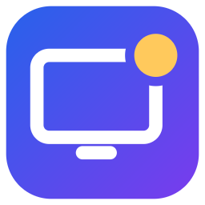
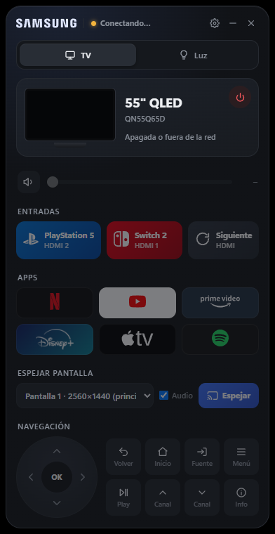
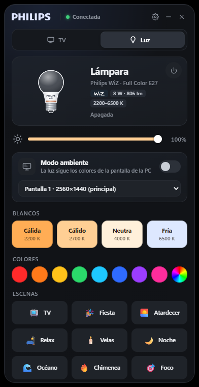

<p align="center">
  
</p>

<h1 align="center">Ambi</h1>

<p align="center">
  <b>El control de tu living, en la bandeja de Windows.</b><br />
  Manejá tu Smart TV, cambiá a la consola, espejá la PC en la tele y hacé que la luz siga lo que ves.
</p>

<p align="center">
  <a href="https://github.com/TaiboAgustin/ambi-desktop/releases/latest">Descargar</a> ·
  <a href="#-cómo-se-usa">Cómo se usa</a> ·
  <a href="#-compatibilidad">Compatibilidad</a> ·
  <a href="#-para-desarrolladores">Desarrollo</a> ·
  <a href="docs/device-agnostic-proposal.md">Hoja de ruta</a>
</p>

<p align="center">
  
  &nbsp;&nbsp;
  
</p>

---

## ✨ Qué hace

**📺 Pestaña TV**
- Ve el estado real de la tele: si está prendida, qué app está en pantalla, el volumen exacto.
- Prendela y apagala, subí o bajá el volumen con un slider (o la rueda del mouse).
- Cambiá de entrada con un clic: **PS5**, **Nintendo Switch 2** o la siguiente HDMI.
- Abrí **Netflix, YouTube, Prime Video, Disney+, Apple TV y Spotify** directamente.
- Navegá como con el control: flechas, OK, volver, inicio, canales… también desde el teclado.
- **Espejá la pantalla de tu PC en la tele** en 1080p a 60 fps, por la red y sin cables.

**💡 Pestaña Luz**
- Prendé, apagá y regulá el brillo.
- Elegí blancos (de cálido a frío), colores o escenas (TV, Fiesta, Atardecer, Velas…).
- **Modo ambiente**: la luz copia en tiempo real los colores de la pantalla de tu PC. Ideal para películas
  y juegos. Al apagarlo, la luz vuelve a como estaba.

**🪟 Vive en la bandeja**
- Cerrar la ventana no la cierra: queda junto al reloj, lista para usar (como Razer Synapse o Discord).
- Desde el ícono: prender la TV o la luz, activar el modo ambiente o abrir Ambi.
- Opción **Iniciar con Windows**. `Ctrl + Alt + T` la muestra u oculta desde cualquier programa.

## 🧩 Compatibilidad

Ambi v1 funciona con estos dispositivos. Queremos sumar más marcas: mirá la
[propuesta para hacerlo agnóstico](docs/device-agnostic-proposal.md) y [cómo contribuir](CONTRIBUTING.md).

| Dispositivo | Soporte | Probado con |
|---|---|---|
| **TV Samsung** con Tizen (2016 en adelante) | Estado, encendido, volumen, teclas, apps, entradas | QLED Q65D 55" (2024) |
| **TV con Google Cast integrado** | Espejo de pantalla | Samsung Q65D |
| **Luces Philips WiZ** (Wi-Fi) | Encendido, brillo, blancos, color, escenas, modo ambiente | WiZ Full Color E27 |
| **SmartThings** (opcional) | Elegir el HDMI exacto de cada consola | Cuenta Samsung |

**Requisitos:** Windows 10 u 11 (64 bits), la PC y los dispositivos en la misma red.

## 🚀 Instalación

1. Descargá **`Ambi-Setup-x.y.z.exe`** desde [Releases](https://github.com/TaiboAgustin/ambi-desktop/releases/latest).
2. Ejecutalo. Como el instalador no está firmado digitalmente, Windows puede mostrar *"Windows protegió
   tu PC"*: tocá **Más información → Ejecutar de todos modos**.
3. Se instala solo para tu usuario (no pide administrador) y crea accesos en el escritorio y el menú Inicio.
4. La primera vez, Windows puede preguntar si Ambi puede usar la red: permitilo en **redes privadas**
   (lo necesita el espejo de pantalla).

## 🔌 Primeros pasos

Ambi **busca la tele y la luz solo** en tu red. Después hay que hacer un par de cosas, una única vez:

**En la tele**
- Cuando Ambi se conecte, aparece un aviso para permitir a **"Ambi"**: aceptalo con el control.
- Para poder **prenderla** desde la PC: *Configuración → General → Red → Configuración experta →
  Encender con dispositivo móvil*.
- La primera vez que espejes, la tele pide permiso para transmitir: aceptalo.

**En la luz WiZ**
- En la app WiZ: *Configuración → Seguridad → Permitir comunicación local*. Sin esto la luz ignora a Ambi.

**Entradas exactas (opcional, con SmartThings)**

Las teles Samsung nuevas no dejan elegir "HDMI 2" por la red local; sin SmartThings, Ambi alterna entre
consolas con la tecla HDMI (funciona, pero puede desincronizarse si cambiás de entrada con el control).
Para elegir la entrada exacta:
1. En Ambi, abrí ⚙️ **Ajustes → SmartThings → Abrí la página de tokens**.
2. Iniciá sesión con tu cuenta Samsung y generá un token con permisos de **Apps** y **Dispositivos**.
3. Pegalo en Ambi, tocá **Conectar** y aprobá el acceso en la ventana que se abre.

El token se usa una sola vez: Ambi crea su propio acceso, lo guarda cifrado y lo renueva solo.
Podés borrar el token de la página de Samsung cuando quieras.

En **Ajustes** también elegís en qué HDMI está cada consola, la calidad del espejo y si Ambi está siempre
visible.

## 🎮 Cómo se usa

| Atajo | Acción | Atajo | Acción |
|---|---|---|---|
| Flechas / Enter | Mover / OK | `P` | Prender o apagar la TV |
| Retroceso / Esc | Volver | `+` `−` / rueda | Volumen |
| `H` | Inicio | `M` | Silencio |
| `S` | Fuente | `Espacio` | Play / pausa |
| `I` | Info | RePág / AvPág | Canal |
| `F1` / `F2` / `F3` | PS5 / Switch 2 / Siguiente HDMI | `0`–`9` | Números |
| `L` | Prender o apagar la luz | `A` | Modo ambiente |
| `Ctrl + 1` / `Ctrl + 2` | Pestaña TV / Luz | `Ctrl + Alt + T` | Mostrar u ocultar Ambi |

**Espejo de pantalla:** en la pestaña TV elegí qué pantalla mandar, si querés audio, y tocá **Espejar**.
Ambi abre el visor en la tele por Google Cast y transmite por WebRTC dentro de tu red (el video no pasa
por internet). Para cortar, tocá **Detener** o apretá Inicio en el control de la tele.

**Modo ambiente:** en la pestaña Luz activá el interruptor y elegí qué pantalla seguir. El slider de brillo
pasa a ser el **brillo máximo**. Tocar un color, blanco o escena lo apaga.

## 🔒 Privacidad y seguridad

- Todo funciona **dentro de tu red local**. Lo único que usa internet es SmartThings (opcional) y el visor
  de Cast que abre la tele.
- Los tokens (de la TV y de SmartThings) se guardan **cifrados** con la protección de tu usuario de Windows.
- El espejo usa una clave aleatoria por sesión: ningún otro equipo de tu red puede ver tu pantalla.
- Ambi no envía datos ni estadísticas a ningún lado.

Tus datos y el registro de actividad están en `%APPDATA%\Ambi` (`config.json` y `logs\ambi.log`).

## 🛠 Solución de problemas

| Problema | Qué probar |
|---|---|
| Dice "Buscando la TV…" todo el tiempo | Verificá que la tele esté prendida y en la misma red. Podés poner su IP a mano en Ajustes. |
| "Rechazado por la TV" | Rechazaste el aviso: tocá **Volver a emparejar** en Ajustes y aceptalo. |
| No prende la TV | Activá *Encender con dispositivo móvil* en la tele. Si la desenchufaste, hay que prenderla con el control. |
| La luz dice "Sin respuesta" | Activá *Permitir comunicación local* en la app WiZ y verificá que esté encendida desde la llave. |
| PS5 y Switch quedan al revés | Sin SmartThings, tocá **Siguiente** una vez para resincronizar, o conectá SmartThings. |
| El espejo no arranca | Permití Ambi en el Firewall de Windows (redes privadas) y aceptá el aviso de transmisión en la tele. |

¿Otra cosa? Abrí un [issue](https://github.com/TaiboAgustin/ambi-desktop/issues) con el contenido de
`%APPDATA%\Ambi\logs\ambi.log`.

## 👩‍💻 Para desarrolladores

```bash
git clone https://github.com/TaiboAgustin/ambi-desktop.git
cd ambi-desktop
npm install
npm start
```

| Comando | Qué hace |
|---|---|
| `npm start` | Ejecuta Ambi (más detalle en el log con la variable `HUB_DEBUG=1`). |
| `npm test` | Tests con `node:test`: dominio, adaptadores contra servidores locales reales y servicios con dobles. |
| `npm run check` | Verifica la sintaxis de todo el proyecto. |
| `npm run dist` | Corre los tests y genera el instalador en `dist/`. |
| `npm run icon` / `npm run logos` | Regeneran el ícono y los logos. |

**Stack:** Electron 44 · Node.js · [`ws`](https://github.com/websockets/ws) · electron-builder. Sin frameworks
de UI ni otras dependencias de ejecución.

**Arquitectura hexagonal** (puertos y adaptadores): el dominio no depende de nada, los casos de uso solo
conocen contratos, y cada integración (Samsung, WiZ, Cast, SmartThings, Electron, disco) es un adaptador
intercambiable. Todo se conecta en un único lugar (`src/main/main.js`). Detalles en
[docs/architecture.md](docs/architecture.md).

```
src/
├── main/
│   ├── domain/        reglas puras (catálogo, modelo de TV, política HDMI, luz, validación)
│   ├── application/   casos de uso, estado observable, sondeo, puertos
│   ├── drivers/       un driver por marca: samsung-tizen · wiz (ver docs/drivers.md)
│   ├── adapters/      smartthings · cast · mirror · storage · electron · net · logging
│   └── main.js        raíz de composición
├── preload/           puente seguro hacia la interfaz
├── renderer/          interfaz (vistas TV, Luz y Ajustes)
├── capture/           ventanas ocultas de captura y visor que corre en la TV
└── shared/            código compartido (algoritmo de color del modo ambiente)
test/                  suite de tests
docs/                  arquitectura, revisión de código y hoja de ruta
```

**Nota para generar el instalador:** si electron-builder falla con `EXDEV` al renombrar archivos de su
caché (pasa en algunos equipos con `AppData` virtualizado), usá un caché dentro del proyecto:
`set ELECTRON_BUILDER_CACHE=.cache\electron-builder` y volvé a correr `npm run dist`.

### Protocolos

Todo lo que Ambi sabe de cada dispositivo se descubrió probando contra el hardware real. Está documentado
en los propios adaptadores, y resumido acá para quien quiera sumar soporte:

<details>
<summary><b>Samsung Tizen</b></summary>

| Qué | Cómo |
|---|---|
| Estado | `GET http://IP:8001/api/v2/` → nombre, modelo, `PowerState`, MAC |
| Control remoto | `wss://IP:8002/api/v2/channels/samsung.remote.control?name=<base64>&token=<t>` |
| Emparejado | Aviso en la TV → `{"event":"ms.channel.connect","data":{"token":…}}` |
| Teclas | `{"method":"ms.remote.control","params":{"Cmd":"Click","DataOfCmd":"KEY_VOLUP",…}}` |
| Volumen exacto | UPnP `RenderingControl` en `http://IP:9197/upnp/control/RenderingControl1` |
| App en pantalla | `GET http://IP:8001/api/v2/applications/<id>` → `{running, visible}` |
| Abrir app | `POST https://IP:8002/api/v2/applications/<id>` |
| Encender | Wake-on-LAN a la MAC Wi-Fi |
| Descubrimiento | SSDP (`urn:dial-multiscreen-org:service:dial:1`) + confirmación por la API |

En modelos 2024 **no** funcionan: `ed.apps.launch` por WebSocket, `KEY_HDMI1…4`, `KEY_TV` ni leer la
entrada activa (por eso existe la opción SmartThings).
</details>

<details>
<summary><b>Philips WiZ</b></summary>

JSON por UDP al puerto 38899: `getPilot` y `setPilot` con `state`, `dimming` (10–100), `temp` (2200–6500 K),
`r/g/b` y `sceneId`. Acepta cambiar tono y brillo estando apagada sin encenderse.
</details>

<details>
<summary><b>Espejo (Google Cast + WebRTC)</b></summary>

Ambi habla CASTV2 (TLS en el puerto 8009) para abrir DashCast (`84912283`) con un visor servido por la propia
PC. La pantalla se captura con `getDisplayMedia` y se transmite por WebRTC (H.264 por GPU); la señalización
exige un token por sesión.
</details>

<details>
<summary><b>SmartThings</b></summary>

Con el token personal (que vence a las 24 h) Ambi crea una app OAuth propia (`API_ONLY`) y guarda un
refresh token cifrado que se renueva solo. La entrada se cambia con `setInputSource("HDMI2")`.
</details>

## 🗺 Hoja de ruta

- [x] v1: TV Samsung, luz WiZ, espejo, modo ambiente, bandeja e instalador.
- [x] Modelo de **drivers por capacidades** para sumar cualquier marca ([guía](docs/drivers.md) · [propuesta](docs/device-agnostic-proposal.md)).
- [ ] Interfaz que se arma según las capacidades de cada dispositivo y entradas con nombre editable.
- [ ] Asistente de inicio con descubrimiento de dispositivos.
- [ ] Varias luces en el modo ambiente.
- [ ] Nuevas marcas: LG webOS, Philips Hue, Android TV, Roku…

Historial de cambios en el [CHANGELOG](CHANGELOG.md).

## 🤝 Contribuir

Las contribuciones son bienvenidas, sobre todo drivers para otros dispositivos. Leé
[CONTRIBUTING.md](CONTRIBUTING.md) y la [guía de drivers](docs/drivers.md) para empezar.

## 📄 Licencia

[MIT](LICENSE) © 2026 Agus Taibo.

Samsung, SmartThings, Philips, WiZ, PlayStation, Nintendo Switch, Netflix, YouTube, Prime Video, Disney+,
Apple TV, Spotify y Google Cast son marcas de sus respectivos dueños. Ambi es un proyecto independiente y no
está afiliado ni respaldado por ninguna de ellas; los logos se usan solo para identificar cada servicio.
